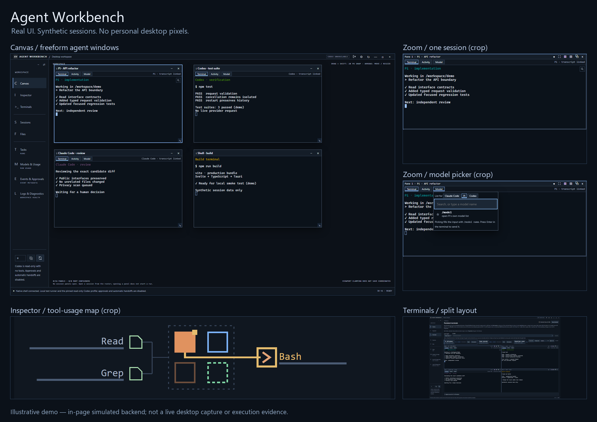

# Agent Workbench

A desktop workspace for coding agents. Keep persistent terminals on a freeform canvas, switch between terminal and activity views, and inspect sessions across Pi, Claude Code and Codex.

**Development preview · Windows-first · no installer or signed release yet.**

The collage shows the real Svelte interface with **synthetic sessions and a simulated backend**. It is not a capture of a personal desktop or evidence of live provider execution. The close-ups are crops. [Full canvas](docs/assets/public/canvas.png) · [Split terminals](docs/assets/public/terminals.png) · [Inspector](docs/assets/public/inspector-map.png).

## What it does

- **Persistent terminals:** sessions are owned by a separate native service, not the GUI window.
- **Canvas and splits:** float, move, resize or tile terminals; use familiar prefix-key navigation.
- **Agent views:** terminal, activity and model-selection surfaces in one workspace.
- **Inspector:** session tiles, state groups and a tool-usage map.
- **Explicit control:** drafts and time-limited grants separate observation from typing authority. Closing the GUI is not the same as ending a terminal.

Local observation does not require a classifier key. Provider CLIs keep their own authentication; this repository contains no credentials or personal session history.

## Stack

Svelte 5 + TypeScript → Tauri 2 + Rust → SQLite / validated JSON. xterm.js renders terminals; Windows ConPTY and separate session hosts own the underlying processes. There is no separate production web server.

| Directory | Purpose |
|---|---|
| `frontend/` | Desktop interface |
| `src-tauri/` | Native application and execution boundaries |
| `crates/wb-session/` | Persistent terminal service and CLI |
| `crates/wb-observe/` | Bounded transcript observation |
| `contracts/` | Versioned interfaces and deterministic fixtures |
| `tools/` | Tests, build helpers and private-to-public export tooling |

## Build and test

Use Windows with Node.js, Python 3.11+, Rust stable, the MSVC C++ build tools / Windows SDK, and WebView2. Native wrapper scripts currently expect a standard Visual Studio 2022 installation; adjust them for your toolchain. Clean-machine packaging is not certified.

```sh
npm --prefix frontend ci
npm --prefix frontend run build
node tools/frontend-tests/run.mjs
python -m unittest tools.public_release.test_public_release -v
```

For the public snapshot's check runner, use `node tools/public-check-all.mjs --quick`; review any skips. Native service end-to-end tests create their own terminal hosts and must run from a normal console, not an agent Job that forbids breakaway. Do not stop existing sessions just to test or rebuild.

The pinned read-only Codex adapter resolves its executable relative to runtime `APPDATA`; absent/relative configuration fails closed. Its executable size/hash verification remains enforced. Installing a different CLI build requires a separate reviewed pin update, not disabling verification.

## Privacy-aware publication

Private development and public history are deliberately separate. A reviewed allowlisted snapshot becomes an independent `public` branch with generic author **and** committer metadata. Private development branches are never merged or pushed into it.

- [Private → public workflow](docs/public/RELEASE.md)
- [Shared agent routing news](docs/public/AGENT_NEWS.md)
- [Reusable release skill](skills/private-to-public/SKILL.md)

**Jev is a shadow sensor, not a safety guarantee.** It records per-line privacy probabilities; Luna 6/max proposes bounded scrubs; deterministic checks, independent review and tests remain authoritative. No measured 99% classifier accuracy is claimed. Email addresses are intentionally allowed and can still identify a contributor. Anonymous Git metadata does not hide a hosting account or network identity.

## Current limits

No installer, signing, auto-update service or production support promise. Native desktop acceptance and clean-machine validation remain separate from headless demos and unit tests. Existing provider permissions are not widened by the release tooling.
